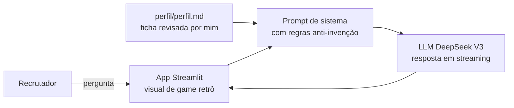

# 👾 MARCOS.EXE: currículo interativo com IA

**Em vez de ler um PDF, o recrutador conversa com o meu currículo.** Ele pergunta o que quiser ("ele já liderou equipe?", "tem algo com agentes de IA?", "me manda o link do projeto de dados") e um LLM responde só com fatos verificados sobre mim, indicando os projetos e links que combinam com o que a pessoa procura.

> 🎮 **Jogue aqui:** _(link do Streamlit)_

<!-- Grave um GIF de 20–40 s, salve em docs/demo.gif e troque esta linha por:  -->

## Como funciona



- **Uma única fonte de verdade.** Tudo o que o bot sabe está em [`perfil/perfil.md`](perfil/perfil.md), um arquivo de texto que eu reviso. Para mudar o que o bot sabe, basta editar a ficha, sem tocar em código.
- **Regras contra invenção.** O prompt proíbe completar lacunas, criar links que não estão na ficha ou opinar sobre assuntos sensíveis. O que não está na ficha vira "melhor perguntar direto ao Marcos" e o contato.
- **Fora de alcance por decisão:** pretensão salarial, disponibilidade, vida pessoal e dados internos de empresa. O bot encaminha esses assuntos para mim em vez de responder.
- **Recomenda pelo interesse.** Se o recrutador diz "procuro alguém de dados", o bot aponta o [Fleet AI Analyst](https://fleet-ai-analyst-marcos.streamlit.app). Se diz "agentes", aponta o [Barbershop Bot](https://github.com/MarcosVVSantos/barbershop-bot).
- **Proteção da demo pública:** são 20 perguntas por sessão, até 500 caracteres por pergunta e respostas curtas. Só as últimas 8 mensagens vão para o modelo, o que controla o custo. Pedidos para ignorar as regras ou revelar o prompt são recusados.
- **Modo demonstração.** Sem chave de API, o app continua funcionando com as respostas do menu.

## Testes

```bash
pip install -r requirements.txt
pytest   # 7 testes: ficha sem telefone, travas no prompt, links só da ficha, limites, modo demo
```

## Rodar localmente

```bash
git clone https://github.com/MarcosVVSantos/chat-portifolio.git
cd chat-portifolio
pip install -r requirements.txt
# opcional: crie .streamlit/secrets.toml a partir do .streamlit/secrets.toml.example
streamlit run app.py
```

## Outros projetos

- [Fleet AI Analyst](https://github.com/MarcosVVSantos/fleet-ai-analyst): agente text-to-SQL com eval de 20 perguntas ([demo](https://fleet-ai-analyst-marcos.streamlit.app)).
- [Barbershop Bot](https://github.com/MarcosVVSantos/barbershop-bot): agente de WhatsApp com 21 ferramentas MCP e 94 testes.

---

Feito por **Marcos Vinicio Vieira dos Santos** · [LinkedIn](https://www.linkedin.com/in/marcos-v-v-santos) · [GitHub](https://github.com/MarcosVVSantos)
